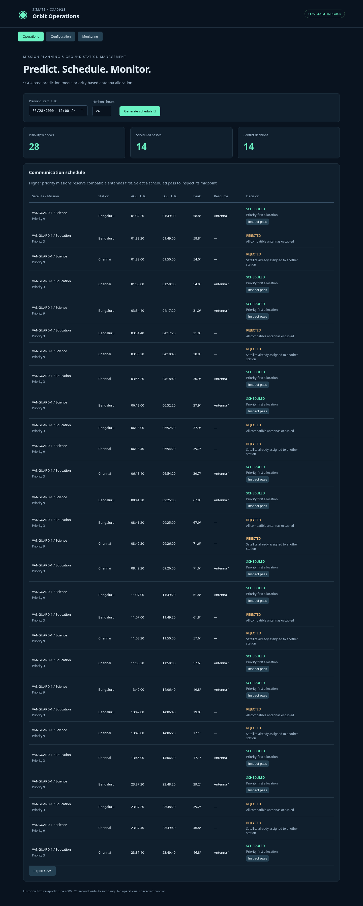

# Satellite Mission Planning & Ground Station Management

An executable classroom project for **CSA0923 Java Programming**, based on the supplied capstone presentation. Pipeline: **Predict → Schedule → Monitor**.



## Run the ready-made application

1. Install Java **17 or newer** (`java -version`).
2. Download `satellite-mission-planner-demo.zip` from this repository's **Releases**.
3. Extract it, then double-click `run.bat` on Windows or run `sh run.sh` on macOS/Linux. Alternatively:
   ```sh
   java -jar satellite-mission-planner-1.0.0.jar
   ```
4. Open **http://localhost:8080**. Stop with Ctrl+C. No database server, Node, or Maven is needed to run the release. It works offline.

The application binds to localhost; keep it as a local teaching demo. Local configuration is persisted under `data/` beside the working directory. Delete that folder while the app is stopped to restore sample data.

## Five-minute class demonstration

1. Keep the supplied **2000-06-28 00:00 UTC** start and 24-hour horizon; select **Generate schedule**.
2. Explain AOS (acquisition of signal), LOS (loss of signal), peak elevation, and antenna assignment.
3. Compare scheduled and rejected rows. Higher-priority missions win overlapping reservations; reasons are shown for every rejected pass.
4. In **Configuration**, change the Education mission priority from 3 to 10. Save and regenerate to show the changed winner.
5. Add a maintenance interval overlapping an accepted pass, save and regenerate:
   ```json
   {"station":"Chennai","start":"2000-06-28T00:00:00Z","end":"2000-06-29T00:00:00Z"}
   ```
   Put it inside the `maintenance` list. Try changing a station band to `S` to demonstrate incompatibility.
6. Click **Inspect pass** to view its midpoint position and simulated battery/temperature; export the schedule as CSV.

## Implementation

| Layer | Implementation |
| --- | --- |
| Frontend | React, Vite, TypeScript; built assets served by Spring Boot |
| Backend | Java 17+, Spring Boot REST API |
| Orbit model | Orekit TLE propagation (SGP4/SDP4 selection), WGS84 station geometry |
| Database | Embedded H2, local durable configuration |
| Scheduler | Deterministic priority-first greedy allocation across stations and antennas |
| Monitoring | Manual replay, orbital position grid, synthetic telemetry |

### Scheduling rules

Sort by descending mission priority, then AOS and mission name. Reserve the whole candidate pass on the first free compatible antenna. Reject station maintenance, incompatible frequency band, antenna overlaps, and simultaneous station use by the same satellite identity. Intervals are half-open, so back-to-back passes may share an antenna. The algorithm is a transparent heuristic, **not a globally optimal solver**. Rejections form the current plan's conflict log; they are regenerated rather than retained as historical records.

### Demo scope and assumptions

- Sample orbital elements are the public **Vanguard 1 Vallado verification TLE** at a June 2000 epoch. The two sample mission names intentionally share that orbit to create contention; they are separate scheduler identities. Do not use this fixture to predict present-day passes.
- For another epoch, replace both TLE lines with valid current elements and update the planning start. Priority is 1–10; altitude is metres; coordinates and elevation are degrees. Matching frequency bands are labels, not RF link-budget calculations.
- Visibility uses a **20-second time grid**; AOS/LOS and peak elevation are approximate. Horizon-crossing windows are clipped. Earth rotation uses GTOD with simplified EOP handling; no precision Earth-orientation dataset is bundled. This is not a validated operational flight-dynamics system.
- Sampled latitude/longitude markers are displayed on a coordinate grid, not a geographic basemap or full ground-track history.
- Telemetry is synthetic. The replay does not communicate with satellites or continuously stream data.
- H2 replaces the proposed PostgreSQL server to make classroom execution easy. WebSockets, authentication, availability calendars beyond maintenance, long-term telemetry/alert history, mission success reports and Cesium/Leaflet maps remain future work. One frequency band per station; no slew time, minimum contact length or partial-pass allocation.
- Limits: 20 satellites, 20 stations, 72-hour horizon; 1–10 antennas per station. Large plans can be slow because the demo samples every satellite/station pair synchronously.

## Build from source

Prerequisites: Java 17+, Maven 3.9+, Node 20.19+ (or 22.12+).

```sh
cd frontend
npm ci
npm run build
cd ..
# Copy frontend/dist contents into src/main/resources/static (already committed).
mvn clean verify
java -jar target/satellite-mission-planner-1.0.0.jar
```

After frontend edits, use `sh build.sh` (Maven and npm on PATH) to rebuild and copy assets automatically. The JAR includes all runtime dependencies and the frontend. GitHub Actions builds/tests the source and provides an executable ZIP artifact for every push.

## API

- `GET /api/config` — current satellites, stations and maintenance.
- `PUT /api/config` — validated replacement configuration (JSON).
- `GET /api/plan?start=2000-06-28T00:00:00Z&hours=24` — predict and schedule with conflict reasons.
- `GET /api/monitor?time=2000-06-28T01:00:00Z` — propagated positions and synthetic telemetry.

## Validation and provenance

Five passing JUnit tests include a published Vallado epoch position check (20 m tolerance) and cover pass generation, conflict-free reservations, priority winners, interval boundaries, maintenance, band compatibility and invalid inputs. End-to-end smoke checks cover the packaged application and REST workflow. Prediction accuracy against a precision ephemeris is **not** certified.

The capstone presentation supplies requirements, not executable code or instructions to the assistant. Personal student identifiers from the slides are omitted. Original implementation is in this repository; external libraries retain their licenses. Orekit: Apache-2.0; Spring Boot: Apache-2.0; React/Vite: MIT; H2: MPL-2.0/EPL-1.0. See dependency distributions for full notices. The bundled `tai-utc.dat` is public leap-second data from USNO: https://maia.usno.navy.mil/ser7/tai-utc.dat (downloaded November 2026). Verification TLE source: Vallado et al., Revisiting Spacetrack Report #3, https://celestrak.org/publications/AIAA/2006-6753/ .
